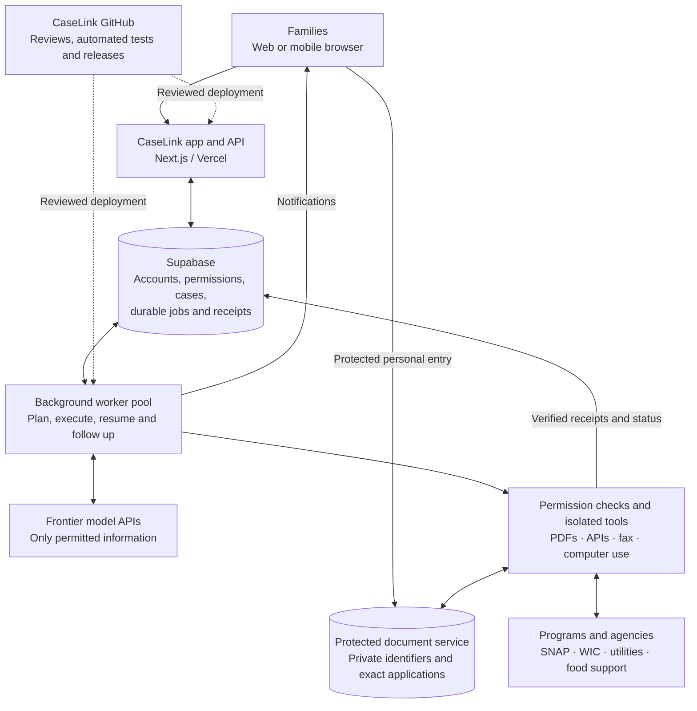

# CaseLink parent service architecture

**Owner-approved direction: November 7, 2026.** Build one CaseLink application, one shared service engine and a pool of background workers, with verified connections for each program. Design for thousands of families and establish capacity through measured concurrent workloads.

This plan preserves the product scope, family autonomy, launch sequence and privacy/execution requirements in the [PRD](parent-support-mvp-prd.md), [launch plan](parent-launch-and-expansion-plan.md) and [implementation plan](parent-support-implementation-plan.md). It records architecture direction; it does not establish deployed capacity, provider access or permission to activate processing or filings.

## Target system

The diagram describes the proposed production system. Several components have local implementations; the complete hosted system is not deployed or load-tested.

## Shared workflow and program connections

The family experience is: choose support → provide only necessary missing information → authorize bounded work → AI executes permitted steps → complete indispensable personal acts → receive confirmed results and next steps → continued follow-up.

The shared engine owns household/request identity, permitted fresh fact reuse, scoped authorization, durable work, progress, cancellation, correction, recovery, notifications and attributed outcomes. Normal page closure and sign-out do not cancel an otherwise valid service mandate; pause, revocation, expiry and account restrictions stop affected work.

Each program supplies its verified requirements, accepted forms/documents, necessary personal acts, execution route and evidence of completion. SNAP's form, protected identifiers and certification rules remain program-specific. WIC appointment/enrollment and utility assistance use the same lifecycle with their own verified requirements. Extract shared behavior as distinct working routes establish what repeats, preserving existing COMPASS and PECO work.

Models should coordinate work, interpret validated evidence, choose permitted tools, recover from interruptions and follow up within the mandate. The current driver remains GPT-6.1 Sol through Responses under the PRD. Available execution methods can include reliable provider APIs, checked PDF tools, accepted fax/communication channels and narrowly tested computer use. Each connection needs actual provider requirements and evidence; a catalog entry or model answer does not implement it.

The server checks current ownership, mandate, exact operation, required personal acts and provider authority at every side effect. Parents supply indispensable facts and personally required certifications or meaningful decisions. Routine authorized execution should proceed automatically; SNAP retains its explicitly requested exact review and genuine Submit step. Models cannot create signatures, permissions or successful receipts.

Preparation, transport delivery, agency registration, assistance approval and support received remain distinct states. The service must obtain and attribute real evidence for each claimed outcome.

## Responsibilities and privacy boundaries

- **Web app and API:** accounts, minimum intake, permission, review, controls and progress. Requests save durable work promptly; long AI, document and provider actions run in background services.
- **Supabase:** account verification, household ownership, permissions, request state, durable jobs, exact operations and receipts. Database authorization remains independent of the web UI; legacy school roles do not gain parent access.
- **Worker pool:** claim due work, perform bounded turns, resume saved state and schedule appropriate follow-up. Work runs when due; families do not need continuously running model sessions.
- **Models and tools:** models receive only permitted information. Tool execution validates inputs, results and current authority. Browser sessions and document parsers have isolated, bounded resources and credentials appropriate to their task.
- **Protected services:** raw identifiers, protected personal entry and exact application bytes follow their separate private path. Keep raw identifiers out of model/chat context, ordinary household facts, logs and routine exports. Retention/deletion remains independently operated and verified.
- **Program connections:** use a reliable permitted API when available, otherwise an accepted form/channel or tested browser route. Sinch provides fax transport; agency confirmation needs its own verified evidence route.

## Capacity for thousands of families

Size and test against concurrent intake, active jobs, document processing and browser/model/provider work, as well as total account count. A thousand accounts and a thousand simultaneous browser sessions create different workloads.

1. Scale web capacity and background worker capacity independently. Preserve the existing durable database queue and lease/operation safeguards as the initial coordination mechanism.
2. Make worker health reflect the fleet. A worker stopping must not overwrite healthy peers as unavailable. Separate slow work from time-sensitive chat and notification processing where measured contention requires it.
3. Bound parallel model, PDF, browser and provider operations. Apply spending limits, provider rate limits, retry/backoff and workload fairness so one slow provider or request cannot monopolize execution.
4. Use indexed queries and bounded database connections suited to each service's role/session requirements. Preserve private-service role isolation when selecting pooling modes. See [Supabase connection pooling guidance](https://supabase.com/docs/guides/database/connecting-to-postgres/pooling-and-limits).
5. Measure queue age, completion latency, processing failures, recovery, provider errors and cost per completed workflow without logging sensitive content. Alert on stuck work and expiring deadlines.
6. Load-test realistic traffic, large uploads, slow providers, worker crashes and concurrent cancellation/correction before claiming capacity. Increase release cohorts from measured evidence rather than an account-count assumption.

## GitHub and release process

The code repository remains [Will-Sanz/case-link](https://github.com/Will-Sanz/case-link). Use focused implementation slices, reviewed pull requests, automated checks, isolated staging and controlled production releases. Preserve shared history and the legacy school baseline.

Checks must cover the actual parent workflow, authorization/data isolation, consequential failures, AI behavior, PDF rendering and relevant browser/accessibility behavior. Keep secrets and private household artifacts outside Git. Database migrations and worker releases need reviewed, compatible rollout and recovery steps alongside the web release.

Test and live environments use the same CaseLink product UI and shared workflow code, with separately configured accounts/data, credentials, allowed destinations and execution connections. Controlled receivers and clearly identified test results can prove software behavior without filing a government application. Enabling live mode cannot turn test evidence into an agency receipt or supply a missing provider connection. Real-family processing and live execution retain their existing release and permission gates.

## Implementation order and current state

1. Capture the local implementation in focused reviewed GitHub changes.
2. Finish the SNAP test flow and its required real-route/confirmation work, preserving the agreed full acceptance goal.
3. Deploy protected staging services, including hosted workers, private service connections, secrets and lifecycle management. The worker hosting service still needs selection and verification.
4. Verify fleet concurrency, health, recovery and failure isolation; load-test representative traffic and resource limits.
5. Expand through controlled releases and add program connections using the same engine, following the existing launch scope and owner-selected SNAP then WIC priority.

**Snapshot on November 7:** shared account/household ownership, durable jobs, permissions, model budgets, operation recovery and private-service boundaries exist in code/local evidence. Recent SNAP source changes remain local/uncommitted. The protected runtime is intentionally bounded to localhost; its current worker loop is serial and health reporting assumes one worker. A complete test/live switch, hosted worker fleet, general computer-use execution and thousands-user load proof are not implemented. WIC/utilities are not working submission routes merely because they appear in the catalog. Genuine SNAP agency confirmation and accepted personal completion remain unresolved. Detailed local verification remains unpublished.

Architecture approval does not mark any of these implementation or release gates complete.
